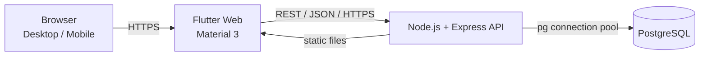
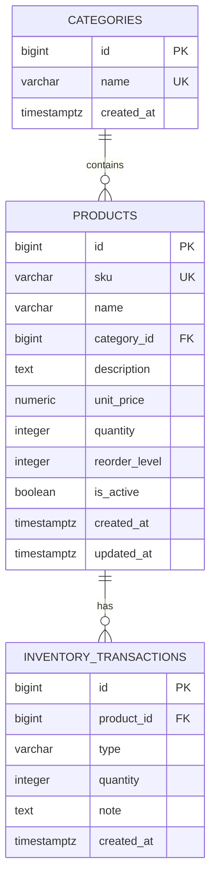

# IMPLEMENTATION PLAN — INVENTORY MANAGEMENT SYSTEM

> Project: Inventory Management System (Hệ thống quản lý kho hàng)
> Course: Cloud Computing
> Stack: Flutter Web + Node.js/Express + PostgreSQL + Render
> Document version: 1.5 — 2026-11-05
> Status: **Phase 6 local preparation complete — waiting for user GitHub/Render actions**

---

## 1. Purpose and scope

This document is the execution plan for the course project described in `PROJECT_REQUIREMENTS.md`.
It defines the architecture, database schema, REST API contract, repository layout, testing
strategy, deployment approach, and the phase-by-phase delivery plan.

### 1.1 Mandatory MVP (P0)

1. **Product management** — list, create, view, edit, soft-delete products.
2. **Product search** — search by name or SKU, filter by category, paginate.
3. **Inventory management** — atomic stock-in / stock-out transactions, current quantity,
   transaction history, reject stock-out when stock is insufficient.

### 1.2 P1 polish (only after P0 works)

- Dashboard with totals, low-stock count, latest transactions.
- Category list and create.
- Delete confirmation dialogs, success/error notifications.
- Responsive desktop/mobile-browser layout.
- Optional sort/filter improvements.

### 1.3 Explicitly out of scope

Authentication, authorization, payments, orders, barcode scanners, multi-warehouse,
suppliers, real-time collaboration, AI, mobile (Android/iOS) builds.

Because there is no authentication, the deployed application is an **educational prototype**,
not a production-secure system. This limitation must be stated in `README.md` and
`docs/DEPLOY_RENDER.md`. No sensitive real business data should be entered into the public demo.

---

## 2. Environment audit (completed in Phase 1)

### 2.1 Current repository

| Item | Result |
|---|---|
| Existing files | `PROJECT_REQUIREMENTS.md`, `IMPLEMENTATION_PLAN.md`, Phase 2 database tooling |
| Git repository | Initialized in Phase 2; `backend/.env` is ignored and never committed |
| Existing code to preserve | None |

### 2.2 Installed tools

| Tool | Version | Status |
|---|---|---|
| Node.js | v24.20.0 | Available (active LTS line) |
| npm | 11.19.0 | Available |
| Flutter | 3.47.2 (stable) | Available |
| Dart | 3.13.2 | Available |
| Git | 2.43.0 | Available |
| PostgreSQL server/client (`psql`, `pg_isready`) | Not installed locally | Not required; remote Render PostgreSQL is used |
| Remote PostgreSQL | Render PostgreSQL 18.6, Oregon | **Available and verified over TLS** |
| Docker | Not installed | Missing (Phase 6 build verification limitation) |
| Local PostgreSQL service | Inactive; port 5432 closed | Not required by the approved plan |

Additional checks:

- `sudo -n true` fails: the current user belongs to the `sudo` group, but a password is required.
  Per user instruction, no local PostgreSQL installation was attempted.
- Network access to npm and pub.dev was verified.
- `DATABASE_URL` is stored only in `backend/.env` (mode `600`, ignored by Git).
- Database access uses `DATABASE_SSL=require` with full certificate verification.

### 2.3 Phase 2 database source (resolved)

The user selected **Option B**: a Render PostgreSQL 18.6 database in Oregon, reached through its
**External Database URL** from the local development machine. Credentials are stored only in
`backend/.env`. No local PostgreSQL installation was performed.

**No mock database or in-memory repository is used in any phase.**

### 2.4 Phase 6 prerequisite

Render and GitHub account access are not available to the agent. Deployment will be prepared
reproducibly and verified only after the user provides access or performs the documented manual
steps. A deployment will never be reported as successful without real HTTP/browser verification.

---

## 3. System architecture

### 3.1 High-level architecture



Rules:

- Flutter never connects directly to PostgreSQL and never receives database credentials.
- All business rules and validation are enforced by the API; client validation is only for UX.
- The API is stateless and can be restarted without losing data.
- All timestamps are stored in UTC (`TIMESTAMPTZ`) and returned as ISO-8601 strings.

### 3.2 Recommended deployment topology (Render)

**Primary approach: one Render Web Service built from a multi-stage Dockerfile.**

```text
Render Web Service (Docker, HTTPS)
├── Express API                 /api/*
└── Compiled Flutter Web        /*
        |
        v
Render PostgreSQL (private network, DATABASE_URL)
```

Why this approach:

- Render's native Node build environment does not include the Flutter SDK. A Docker build makes
  the Flutter build reproducible without relying on undocumented build-image contents.
- Flutter and the API share one origin, which removes CORS complexity in production.
- One public HTTPS URL demonstrates Node.js + PostgreSQL + Render end to end.
- The same Dockerfile can be built and tested locally when Docker is available.

**Allowed fallback: two Render services.**

- Render Web Service for the Node.js API.
- Render Static Site for the Flutter build, produced by a documented GitHub Actions workflow or
  by uploading a pre-built `build/web` artifact.
- Requires a CORS allowlist and a build-time `API_BASE_URL`.

The fallback is documented in `docs/DEPLOY_RENDER.md`; the primary approach is used by default.

### 3.3 Backend request lifecycle

```text
HTTP request
  -> helmet / CORS / body limit / request logging
  -> route (routes/*.routes.js)
  -> zod validation middleware + params validation
  -> controller (HTTP mapping only)
  -> service (business rules, transactions)
  -> repository (parameterized SQL)
  -> pg pool -> PostgreSQL
  -> serializers/mappers
  -> JSON response { data } or { error }
  -> centralized error handler (no stack traces in production)
```

### 3.4 Key technical decisions

| Topic | Decision |
|---|---|
| Backend language | JavaScript ESM (`"type": "module"`), Node.js 24 LTS |
| HTTP framework | Express 5 |
| Validation | `zod` schemas for body, query, and route params |
| DB access | `pg` Pool, parameterized SQL only |
| Money | PostgreSQL `NUMERIC(12,2)`; API returns a JSON number rounded to 2 decimals |
| IDs | PostgreSQL `BIGINT` identity; `pg` int8 parser maps to JS number for demo-scale IDs |
| Soft delete | `products.is_active = false`; no hard-delete endpoint |
| Quantity changes | Only through `POST /api/inventory/transactions` |
| Concurrency | `SELECT ... FOR UPDATE` inside one SQL transaction |
| Migrations | Numbered SQL files + Node migration runner with advisory lock and `schema_migrations` |
| Frontend state | `provider` + `ChangeNotifier` per feature |
| HTTP client | `http` package, single reusable `ApiClient` |
| Routing | `go_router` with path URL strategy + Express SPA fallback |
| UI language | Vietnamese; code, identifiers, and documentation in English |
| Currency | VND formatting via `intl` |
| Deployment | Single Docker Web Service + Render PostgreSQL (primary) |

---

## 4. Technology stack and dependencies

### 4.1 Backend

Runtime dependencies:

- `express` — REST API.
- `pg` — PostgreSQL pool and transactions.
- `zod` — request validation.
- `dotenv` — local environment loading (never committed).
- `helmet` — security headers, CSP configured for Flutter assets.
- `cors` — origin allowlist.
- `compression` — gzip for static assets.
- `morgan` — concise request logging.

Development dependencies:

- `vitest` — test runner.
- `supertest` — HTTP integration tests against the Express app.
- No transpiler; Node.js runs ESM directly.

### 4.2 Frontend

- `http` — REST client.
- `provider` — state management.
- `go_router` — navigation and deep links.
- `intl` — Vietnamese date/number/currency formatting.
- `flutter_lints` — static analysis.
- `flutter_test` — unit and widget tests.

Material 3 theme, no external font download at runtime, no fake production data.

### 4.3 Database

- PostgreSQL 16+ (Render-supported version; confirm current Render default in Phase 6).
- `pg_trgm` extension for efficient `ILIKE '%term%'` search indexes.
  If the extension is unavailable, the schema keeps working without the GIN indexes; this
  fallback is documented in Phase 2.

---

## 5. Repository layout

The structure below will be created across Phases 2–4. Phase 1 defines it and creates the
top-level directories only.

```text
inventory-management/
├── backend/
│   ├── src/
│   │   ├── app.js                     # Express app factory (no listen)
│   │   ├── server.js                  # startup, DB check, graceful shutdown
│   │   ├── config/
│   │   │   ├── load-env.js            # dotenv bootstrap (single load point)
│   │   │   ├── env.js                 # env parsing/validation
│   │   │   ├── cors.js                # origin allowlist policy
│   │   │   └── database.js            # pg Pool, SSL mode, type parsers
│   │   ├── routes/
│   │   │   ├── index.js
│   │   │   ├── health.routes.js
│   │   │   ├── category.routes.js
│   │   │   ├── product.routes.js
│   │   │   ├── inventory.routes.js
│   │   │   └── dashboard.routes.js
│   │   ├── controllers/
│   │   │   ├── health.controller.js
│   │   │   ├── category.controller.js
│   │   │   ├── product.controller.js
│   │   │   ├── inventory.controller.js
│   │   │   └── dashboard.controller.js
│   │   ├── services/
│   │   │   ├── category.service.js
│   │   │   ├── product.service.js
│   │   │   ├── inventory.service.js
│   │   │   ├── dashboard.service.js
│   │   │   └── health.service.js
│   │   ├── repositories/
│   │   │   ├── category.repository.js
│   │   │   ├── product.repository.js
│   │   │   ├── inventory.repository.js
│   │   │   └── dashboard.repository.js
│   │   ├── validators/
│   │   │   ├── common.schema.js
│   │   │   ├── category.schema.js
│   │   │   ├── product.schema.js
│   │   │   └── inventory.schema.js
│   │   ├── middleware/
│   │   │   ├── validate.js
│   │   │   ├── reject-stock-fields.js
│   │   │   ├── not-found.js
│   │   │   ├── error-handler.js
│   │   │   └── async-handler.js
│   │   └── utils/
│   │       ├── errors.js              # AppError subclasses + error codes
│   │       ├── pagination.js
│   │       └── serializers.js
│   ├── tests/
│   │   ├── setup.js
│   │   ├── helpers.js
│   │   ├── health.test.js
│   │   ├── categories.test.js
│   │   ├── products.test.js
│   │   ├── inventory.test.js
│   │   ├── dashboard.test.js
│   │   └── concurrency.test.js
│   ├── scripts/
│   │   ├── migrate.js                 # advisory-locked migration runner
│   │   ├── seed.js                    # production-guarded seed runner
│   │   ├── verify-db.js               # structural/seed verification
│   │   ├── db-operations-test.js      # constraint/concurrency tests
│   │   └── smoke-test.mjs             # real HTTP smoke test (local or deployed)
│   ├── vitest.config.js
│   ├── .env.example
│   ├── package.json
│   └── package-lock.json
├── frontend/
│   ├── lib/
│   │   ├── main.dart
│   │   ├── app.dart
│   │   ├── core/
│   │   │   ├── config/app_config.dart
│   │   │   ├── network/api_client.dart
│   │   │   ├── network/api_exception.dart
│   │   │   ├── router/app_router.dart
│   │   │   ├── theme/app_theme.dart
│   │   │   └── utils/formatters.dart
│   │   ├── models/
│   │   │   ├── category.dart
│   │   │   ├── product.dart
│   │   │   ├── inventory_transaction.dart
│   │   │   ├── dashboard_summary.dart
│   │   │   └── paginated_result.dart
│   │   ├── services/
│   │   │   ├── category_service.dart
│   │   │   ├── product_service.dart
│   │   │   ├── inventory_service.dart
│   │   │   └── dashboard_service.dart
│   │   ├── state/
│   │   │   ├── product_list_state.dart
│   │   │   ├── product_form_state.dart
│   │   │   ├── inventory_state.dart
│   │   │   └── dashboard_state.dart
│   │   ├── screens/
│   │   │   ├── shell/app_shell.dart
│   │   │   ├── dashboard/dashboard_screen.dart
│   │   │   ├── products/product_list_screen.dart
│   │   │   ├── products/product_detail_screen.dart
│   │   │   ├── products/product_form_dialog.dart
│   │   │   ├── inventory/inventory_screen.dart
│   │   │   ├── categories/categories_screen.dart
│   │   │   └── not_found_screen.dart
│   │   └── widgets/
│   │       ├── stat_card.dart
│   │       ├── product_table.dart
│   │       ├── product_card.dart
│   │       ├── stock_badge.dart
│   │       ├── empty_state.dart
│   │       ├── error_state.dart
│   │       ├── loading_state.dart
│   │       ├── confirm_dialog.dart
│   │       └── transaction_dialog.dart
│   ├── test/
│   │   ├── models_test.dart
│   │   ├── formatters_test.dart
│   │   └── product_form_test.dart
│   ├── web/
│   ├── pubspec.yaml
│   └── pubspec.lock
├── database/
│   ├── schema.sql                     # psql entry point -> \ir migrations/001_init.sql
│   ├── seed.sql                       # idempotent demo data
│   └── migrations/
│       └── 001_init.sql               # canonical schema
├── docs/
│   ├── API.md
│   ├── ARCHITECTURE.md
│   ├── DATABASE.md
│   ├── DEPLOY_RENDER.md
│   ├── TEST_PLAN.md
│   └── screenshots/
│       └── README.md                  # required screenshot checklist
├── Dockerfile                         # multi-stage Flutter + Node
├── .dockerignore
├── render.yaml                        # optional Render Blueprint
├── .gitignore
├── README.md
├── IMPLEMENTATION_PLAN.md
└── PROJECT_REQUIREMENTS.md
```

---

## 6. PostgreSQL database design

### 6.1 Entity relationship diagram



### 6.2 Canonical DDL (implemented in `database/migrations/001_init.sql`)

```sql
BEGIN;

CREATE EXTENSION IF NOT EXISTS pg_trgm;

CREATE TABLE IF NOT EXISTS categories (
  id          BIGINT GENERATED ALWAYS AS IDENTITY PRIMARY KEY,
  name        VARCHAR(100) NOT NULL,
  created_at  TIMESTAMPTZ NOT NULL DEFAULT NOW(),
  CONSTRAINT categories_name_unique UNIQUE (name),
  CONSTRAINT categories_name_not_blank CHECK (btrim(name) <> '')
);

CREATE TABLE IF NOT EXISTS products (
  id             BIGINT GENERATED ALWAYS AS IDENTITY PRIMARY KEY,
  sku            VARCHAR(50) NOT NULL,
  name           VARCHAR(200) NOT NULL,
  category_id    BIGINT NOT NULL,
  description    TEXT NULL,
  unit_price     NUMERIC(12,2) NOT NULL,
  quantity       INTEGER NOT NULL DEFAULT 0,
  reorder_level  INTEGER NOT NULL DEFAULT 5,
  is_active      BOOLEAN NOT NULL DEFAULT TRUE,
  created_at     TIMESTAMPTZ NOT NULL DEFAULT NOW(),
  updated_at     TIMESTAMPTZ NOT NULL DEFAULT NOW(),
  CONSTRAINT products_sku_unique UNIQUE (sku),
  CONSTRAINT products_category_fk FOREIGN KEY (category_id)
    REFERENCES categories(id) ON DELETE RESTRICT,
  CONSTRAINT products_unit_price_nonnegative CHECK (unit_price >= 0),
  CONSTRAINT products_quantity_nonnegative CHECK (quantity >= 0),
  CONSTRAINT products_reorder_level_nonnegative CHECK (reorder_level >= 0),
  CONSTRAINT products_sku_not_blank CHECK (btrim(sku) <> ''),
  CONSTRAINT products_name_not_blank CHECK (btrim(name) <> '')
);

CREATE TABLE IF NOT EXISTS inventory_transactions (
  id          BIGINT GENERATED ALWAYS AS IDENTITY PRIMARY KEY,
  product_id  BIGINT NOT NULL,
  type        VARCHAR(10) NOT NULL,
  quantity    INTEGER NOT NULL,
  note        TEXT NULL,
  created_at  TIMESTAMPTZ NOT NULL DEFAULT NOW(),
  CONSTRAINT inventory_product_fk FOREIGN KEY (product_id)
    REFERENCES products(id) ON DELETE RESTRICT,
  CONSTRAINT inventory_type_valid CHECK (type IN ('IN', 'OUT')),
  CONSTRAINT inventory_quantity_positive CHECK (quantity > 0)
);

-- Case-insensitive SKU uniqueness in addition to the column constraint.
CREATE UNIQUE INDEX IF NOT EXISTS products_sku_upper_unique
  ON products (UPPER(sku));

-- Category names are unique regardless of letter case.
CREATE UNIQUE INDEX IF NOT EXISTS categories_name_lower_unique
  ON categories (LOWER(name));

-- Product list/search/filter indexes.
CREATE INDEX IF NOT EXISTS products_category_idx
  ON products (category_id);
CREATE INDEX IF NOT EXISTS products_active_created_idx
  ON products (is_active, created_at DESC, id DESC);
CREATE INDEX IF NOT EXISTS products_name_trgm_idx
  ON products USING GIN (name gin_trgm_ops);
CREATE INDEX IF NOT EXISTS products_sku_trgm_idx
  ON products USING GIN (sku gin_trgm_ops);

-- Transaction history indexes.
CREATE INDEX IF NOT EXISTS transactions_product_created_idx
  ON inventory_transactions (product_id, created_at DESC, id DESC);
CREATE INDEX IF NOT EXISTS transactions_created_idx
  ON inventory_transactions (created_at DESC, id DESC);
CREATE INDEX IF NOT EXISTS transactions_type_idx
  ON inventory_transactions (type);

-- updated_at maintenance. clock_timestamp() ensures an update in the same
-- transaction as an insert still receives a later timestamp.
CREATE OR REPLACE FUNCTION set_updated_at()
RETURNS TRIGGER AS $$
BEGIN
  NEW.updated_at = clock_timestamp();
  RETURN NEW;
END;
$$ LANGUAGE plpgsql;

DROP TRIGGER IF EXISTS products_set_updated_at ON products;
CREATE TRIGGER products_set_updated_at
  BEFORE UPDATE ON products
  FOR EACH ROW
  EXECUTE FUNCTION set_updated_at();

COMMIT;
```

`database/schema.sql` is a thin psql entry point:

```sql
\ir migrations/001_init.sql
```

### 6.3 Consistency rules

1. A new product is created with `quantity = 0`. The create API rejects a supplied quantity.
2. `products.quantity` is changed **only** by `POST /api/inventory/transactions`.
3. `PUT /api/products/:id` updates metadata only. Sending `quantity` or `isActive` returns
   `400 FIELD_NOT_EDITABLE`.
4. Stock-out is rejected when `quantity < requested quantity` (`409 INSUFFICIENT_STOCK`).
5. Stock movement on an inactive product is rejected (`409 PRODUCT_INACTIVE`).
6. Delete is soft: `is_active = false`. Historical transactions and the product row remain.
7. Inactive products are excluded from list, search, dashboard totals, and stock movement.
8. Category deletion is not exposed in the MVP; the FK is `ON DELETE RESTRICT`.

### 6.4 Atomic stock transaction algorithm

```text
BEGIN;
  SELECT id, sku, name, quantity, reorder_level, is_active
    FROM products
   WHERE id = $1
   FOR UPDATE;

  IF not found            -> ROLLBACK, 404 PRODUCT_NOT_FOUND
  IF is_active = false    -> ROLLBACK, 409 PRODUCT_INACTIVE

  IF type = 'OUT' AND quantity < requested
                          -> ROLLBACK, 409 INSUFFICIENT_STOCK

  UPDATE products
     SET quantity = quantity + delta
   WHERE id = $1
   RETURNING ...;

  INSERT INTO inventory_transactions (product_id, type, quantity, note)
  VALUES ($1, $2, $3, $4)
  RETURNING ...;
COMMIT;
```

- `delta = +requested` for `IN`, `-requested` for `OUT`.
- `SELECT ... FOR UPDATE` serializes concurrent stock changes for the same product.
- Any failure rolls back both the quantity update and the history insert.
- The pool client is always released in `finally`.
- Concurrency test plan: starting stock 10, two parallel OUT requests of 7 must produce exactly
  one success, one `409`, final quantity 3, and exactly one transaction row.

### 6.5 Search and filtering behavior

- `q` matches `products.name ILIKE '%q%'` OR `products.sku ILIKE '%q%'`.
- Search and filter only consider `is_active = TRUE`.
- `categoryId` filters `products.category_id`.
- Default ordering: `created_at DESC, id DESC`.
- Pagination: `page` default 1, `limit` default 20, maximum 100.
- GIN trigram indexes support partial matches; correctness does not depend on them.

### 6.6 Soft-delete policy

| Operation | Behavior |
|---|---|
| `DELETE /api/products/:id` | Sets `is_active = false`; returns 200 with `{ id, isActive: false }` |
| `GET /api/products` | Excludes inactive products |
| `GET /api/products/:id` | Returns 404 for inactive products |
| `POST /api/inventory/transactions` | Rejects inactive products |
| `GET /api/inventory/transactions?productId=` | Still returns history for inactive products |
| Hard delete | Not exposed |

### 6.7 Seed data plan

`database/seed.sql` will be idempotent (`ON CONFLICT DO NOTHING`) and create:

- 5 categories: Thiết bị điện tử, Văn phòng phẩm, Nội thất, Phụ kiện, Lưu trữ.
- 12 products with realistic Vietnamese names and VND prices (SKUs such as `ELEC-001`).
- Initial stock and optional stock-out history that are **internally consistent**:
  - Products start with quantity 0 in the insert.
  - Matching `IN` / `OUT` transaction rows are inserted.
  - Final `products.quantity` equals `SUM(IN) - SUM(OUT)`.
  - Each transaction has a realistic note (e.g., "Nhập hàng đợt đầu", "Xuất bán đơn #1002").
- At least 2 low-stock products and 1 out-of-stock product for UI demonstration.
- Seed timestamps are deterministic enough for repeatable demos but remain realistic.

**Implemented in Phase 2:** 5 categories, 12 products, 24 transactions, 4 low-stock products,
and 1 out-of-stock product. The consistency query confirmed every quantity equals
`SUM(IN) - SUM(OUT)`.

The seed runner (`npm run db:seed`) executes the file in one transaction and refuses to run in
production unless `ALLOW_PROD_SEED=true` is explicitly set.

### 6.8 Migration and seed execution

```bash
# Fresh local database (psql)
createdb inventory
psql "$DATABASE_URL" -v ON_ERROR_STOP=1 -f database/schema.sql

# Or via the Node runner (tracks schema_migrations)
cd backend
npm run db:migrate

# Optional demo data
npm run db:seed
```

The migration runner:

1. Connects with `DATABASE_URL`.
2. Acquires a PostgreSQL advisory lock to prevent concurrent deployments from racing.
3. Creates `schema_migrations (version TEXT PRIMARY KEY, applied_at TIMESTAMPTZ)`.
4. Applies unapplied files from `database/migrations/` in lexical order, one transaction each.
5. Releases the lock and closes the pool.
6. Locates migrations via `MIGRATIONS_DIR` or by trying `./database/migrations` and
   `../database/migrations` so it works both locally and inside the Docker image.

### 6.9 Test database strategy

- A separate database (e.g. `inventory_test`) referenced by `TEST_DATABASE_URL`.
- Tests run migrations once, then `TRUNCATE inventory_transactions, products, categories
  RESTART IDENTITY CASCADE` before each test.
- Vitest runs test files sequentially (`fileParallelism: false`) against the shared database.
- Production and development databases are never used by the test suite.

---

## 7. REST API design

### 7.1 Conventions

- Base path: `/api`.
- Content type: `application/json; charset=utf-8`.
- Success envelope: `{ "data": ... }`, optionally `{ "data": ..., "meta": ... }`.
- Error envelope:

```json
{
  "error": {
    "code": "VALIDATION_ERROR",
    "message": "Request validation failed",
    "details": [
      { "field": "unitPrice", "message": "unitPrice must be greater than or equal to 0" }
    ]
  }
}
```

- Dates: ISO-8601 UTC, e.g. `2026-11-03T08:15:30.000Z`.
- IDs: JSON numbers (demo-scale identity values; documented limitation).
- Money: JSON number rounded to 2 decimals; DB remains `NUMERIC(12,2)`.
- Pagination metadata:

```json
{
  "page": 1,
  "limit": 20,
  "total": 57,
  "totalPages": 3,
  "hasNext": true,
  "hasPrev": false
}
```

- No secrets, raw SQL errors, or stack traces in responses.
- All SQL uses `$1`, `$2`, ... parameters.

### 7.2 Status codes and error codes

| HTTP | Code | When |
|---|---|---|
| 200 | — | Successful read/update/soft-delete |
| 201 | — | Product/category/transaction created |
| 400 | `VALIDATION_ERROR` | Invalid body, query, or params |
| 400 | `CATEGORY_NOT_FOUND` | Referenced category does not exist |
| 400 | `FIELD_NOT_EDITABLE` | `quantity` or `isActive` sent to product update |
| 404 | `PRODUCT_NOT_FOUND` | Missing or inactive product |
| 404 | `ROUTE_NOT_FOUND` | Unknown API route |
| 409 | `DUPLICATE_SKU` | SKU already exists (case-insensitive) |
| 409 | `CATEGORY_EXISTS` | Category name already exists |
| 409 | `INSUFFICIENT_STOCK` | Stock-out exceeds available quantity |
| 409 | `PRODUCT_INACTIVE` | Stock movement attempted on soft-deleted product |
| 413 | `PAYLOAD_TOO_LARGE` | JSON body exceeds limit |
| 403 | `CORS_ORIGIN_DENIED` | Origin not in allowlist |
| 503 | `DB_UNAVAILABLE` | Database connection/query unavailable |
| 500 | `INTERNAL_ERROR` | Unexpected server error |

### 7.3 Endpoint summary

| Method | Path | Purpose | Auth |
|---|---|---|---|
| GET | `/api/health` | Service + database health | No |
| GET | `/api/categories` | List categories with active product counts | No |
| POST | `/api/categories` | Create category (P1) | No |
| GET | `/api/products` | List/search/filter/paginate active products | No |
| GET | `/api/products/:id` | Product detail | No |
| POST | `/api/products` | Create product with quantity 0 | No |
| PUT | `/api/products/:id` | Update metadata only | No |
| DELETE | `/api/products/:id` | Soft-delete product | No |
| POST | `/api/inventory/transactions` | Atomic stock IN/OUT | No |
| GET | `/api/inventory/transactions` | Transaction history | No |
| GET | `/api/dashboard/summary` | Dashboard statistics + latest transactions | No |

### 7.4 Endpoint details and examples

#### GET `/api/health`

Checks `SELECT 1` with a short timeout.

```json
{
  "data": {
    "status": "ok",
    "database": "up",
    "uptimeSeconds": 123,
    "timestamp": "2026-11-03T08:15:30.000Z"
  }
}
```

Returns `503` with `{ "error": { "code": "DB_UNAVAILABLE", "message": "Database is unavailable" } }`
when the check fails. No connection strings or credentials are exposed.

#### GET `/api/categories`

```json
{
  "data": [
    {
      "id": 1,
      "name": "Thiết bị điện tử",
      "productCount": 5,
      "createdAt": "2026-11-03T08:00:00.000Z"
    }
  ]
}
```

`productCount` counts active products only.

#### POST `/api/categories`

Request:

```json
{ "name": "Thiết bị điện tử" }
```

- 201 + `Location: /api/categories/:id` on success.
- 400 on blank/too-long name.
- 409 `CATEGORY_EXISTS` on duplicate.

#### GET `/api/products?q=&categoryId=&page=&limit=`

- `q`: optional string, trimmed, max 100, matches name or SKU partially (case-insensitive).
- `categoryId`: optional positive integer.
- `page`: integer >= 1, default 1.
- `limit`: integer 1–100, default 20.
- `sort`: optional; one of `createdAt`, `updatedAt`, `name`, `sku`, `unitPrice`, `quantity`; default `createdAt`.
- `order`: optional; `asc` or `desc`; default `desc`.
- Inactive products are excluded.
- The `meta` object echoes the applied `sort` and `order` values.

Example response:

```json
{
  "data": [
    {
      "id": 3,
      "sku": "ELEC-003",
      "name": "Bàn phím cơ",
      "categoryId": 1,
      "categoryName": "Thiết bị điện tử",
      "description": "Bàn phím cơ 87 phím",
      "unitPrice": 1290000,
      "quantity": 24,
      "reorderLevel": 5,
      "stockStatus": "IN_STOCK",
      "isActive": true,
      "createdAt": "2026-11-03T08:00:00.000Z",
      "updatedAt": "2026-11-03T08:00:00.000Z"
    }
  ],
  "meta": {
    "page": 1,
    "limit": 20,
    "total": 1,
    "totalPages": 1,
    "hasNext": false,
    "hasPrev": false
  }
}
```

`stockStatus` is computed by the API:

- `OUT_OF_STOCK`: `quantity = 0`
- `LOW_STOCK`: `quantity > 0 AND quantity <= reorder_level`
- `IN_STOCK`: otherwise

#### GET `/api/products/:id`

- 200 with one product object.
- 404 `PRODUCT_NOT_FOUND` for missing or inactive products.
- 400 `VALIDATION_ERROR` for a non-positive/non-integer ID.

#### POST `/api/products`

Request:

```json
{
  "sku": "ELEC-010",
  "name": "Màn hình 27 inch",
  "categoryId": 1,
  "description": "Màn hình IPS 2K",
  "unitPrice": 4500000,
  "reorderLevel": 3
}
```

- SKU is trimmed and normalized to uppercase.
- `quantity` is not accepted; new products start at 0.
- 201 + `Location: /api/products/:id`.
- 400 if category does not exist or fields are invalid.
- 409 `DUPLICATE_SKU` on conflict (case-insensitive).

#### PUT `/api/products/:id`

Request (full metadata update):

```json
{
  "sku": "ELEC-010",
  "name": "Màn hình 27 inch 2K",
  "categoryId": 1,
  "description": "Màn hình IPS 2K, 100Hz",
  "unitPrice": 4690000,
  "reorderLevel": 4
}
```

- Sending `quantity` or `isActive` returns 400 `FIELD_NOT_EDITABLE`.
- 404 for missing/inactive product.
- 409 for duplicate SKU.
- 200 with updated product.

#### DELETE `/api/products/:id`

- Soft delete: `is_active = false`.
- 200 with `{ "data": { "id": 3, "sku": "ELEC-003", "isActive": false } }`.
- 404 if product is missing or already inactive.
- No hard delete; history remains queryable.

#### POST `/api/inventory/transactions`

Request:

```json
{
  "productId": 3,
  "type": "OUT",
  "quantity": 5,
  "note": "Xuất bán đơn #1002"
}
```

- `type`: `IN` or `OUT`.
- `quantity`: positive integer, max 1,000,000.
- `note`: optional, max 500 characters.
- 201 response:

```json
{
  "data": {
    "transaction": {
      "id": 42,
      "productId": 3,
      "productSku": "ELEC-003",
      "productName": "Bàn phím cơ",
      "type": "OUT",
      "quantity": 5,
      "note": "Xuất bán đơn #1002",
      "createdAt": "2026-11-03T08:20:00.000Z"
    },
    "product": {
      "id": 3,
      "sku": "ELEC-003",
      "quantity": 19,
      "stockStatus": "IN_STOCK",
      "updatedAt": "2026-11-03T08:20:00.000Z"
    }
  }
}
```

- 404 `PRODUCT_NOT_FOUND` if missing.
- 409 `PRODUCT_INACTIVE` if soft-deleted.
- 409 `INSUFFICIENT_STOCK` if `OUT` exceeds current quantity; no rows change.
- 400 for invalid quantity/type.

#### GET `/api/inventory/transactions?productId=&page=&limit=`

- `productId`: optional positive integer.
- `page`/`limit`: same pagination rules.
- Optional P1 filters: `type=IN|OUT`, `from`, `to` (ISO dates).
- Ordered by `created_at DESC, id DESC`.
- Includes product SKU/name via join, including inactive products for history.

```json
{
  "data": [
    {
      "id": 42,
      "productId": 3,
      "productSku": "ELEC-003",
      "productName": "Bàn phím cơ",
      "type": "OUT",
      "quantity": 5,
      "note": "Xuất bán đơn #1002",
      "createdAt": "2026-11-03T08:20:00.000Z"
    }
  ],
  "meta": {
    "page": 1,
    "limit": 20,
    "total": 1,
    "totalPages": 1,
    "hasNext": false,
    "hasPrev": false
  }
}
```

#### GET `/api/dashboard/summary`

```json
{
  "data": {
    "totalActiveProducts": 12,
    "totalUnitsInStock": 420,
    "lowStockProducts": 3,
    "outOfStockProducts": 1,
    "inventoryValue": 123456789,
    "recentTransactions": [
      {
        "id": 42,
        "productId": 3,
        "productSku": "ELEC-003",
        "productName": "Bàn phím cơ",
        "type": "OUT",
        "quantity": 5,
        "note": "Xuất bán đơn #1002",
        "createdAt": "2026-11-03T08:20:00.000Z"
      }
    ]
  }
}
```

Definitions:

- `totalActiveProducts`: count of `is_active = TRUE`.
- `totalUnitsInStock`: `SUM(quantity)` of active products.
- `lowStockProducts`: active products with `quantity > 0 AND quantity <= reorder_level`.
- `outOfStockProducts`: active products with `quantity = 0`.
- `inventoryValue`: `SUM(quantity * unit_price)` of active products, rounded to 2 decimals.
- `recentTransactions`: latest 10, newest first.

### 7.5 Validation rules

| Field | Rule |
|---|---|
| `id`, `productId`, `categoryId` | positive integer, safe range |
| `sku` | trim + uppercase; 1–50 chars; `^[A-Z0-9][A-Z0-9._-]*$` |
| `name` | trim; 1–200 chars |
| `description` | optional; max 2000 chars; empty string -> null |
| `unitPrice` | number >= 0 and <= 9999999999.99; max 2 decimals |
| `reorderLevel` | integer 0–1,000,000 |
| transaction `quantity` | integer 1–1,000,000 |
| transaction `type` | `IN` or `OUT` |
| `note` | optional; max 500 chars; empty string -> null |
| `q` | trim; max 100 chars |
| `page` | integer >= 1 |
| `limit` | integer 1–100 |
| category `name` | trim; 1–100 chars |

Validation details are returned per field. Server validation is authoritative.

### 7.6 Security and middleware behavior

- `helmet` with a CSP that supports Flutter Web's generated bootstrap script and CanvasKit:
  `script-src 'self' 'unsafe-inline'`, `style-src 'self' 'unsafe-inline'`,
  `img-src 'self' data: blob:`, `font-src 'self' data:`, `connect-src 'self'`,
  `worker-src 'self' blob:`. The `'unsafe-inline'` trade-off is documented because Flutter's
  generated `index.html` contains an inline bootstrap script. API-only deployments can tighten it.
- CORS allowlist:
  - Comma-separated `FRONTEND_ORIGIN`.
  - Render's `RENDER_EXTERNAL_URL` (same-origin deployment).
  - `http://localhost:*` / `http://127.0.0.1:*` only when `NODE_ENV !== 'production'`.
  - Requests with no `Origin` (curl, same-origin) are allowed.
- `express.json({ limit: '100kb' })`.
- Rate limiting is optional P1; if added, it is disabled in tests.
- Central error handler maps known `AppError`s, zod errors, PG unique/FK errors, and connection
  errors; unknown errors return 500 with a generic message and are logged server-side.
- Graceful shutdown on `SIGTERM`/`SIGINT`: stop accepting requests, close the pool.
- Startup retries the database check with backoff so a Render database that is still starting does
  not crash the service immediately.
- Health endpoint performs a lightweight query and never leaks secrets.

---

## 8. Flutter Web frontend design

### 8.1 Application shell

- Material 3, seed color (deep teal/blue), light theme.
- Desktop (>= 1024 px): fixed 240 px sidebar + content area.
- Tablet (600–1023 px): `NavigationRail`.
- Mobile (< 600 px): hamburger `Drawer`; tables become cards.
- Top bar: screen title, refresh action, API connection indicator.
- Navigation: Dashboard, Sản phẩm, Kho hàng, Danh mục.
- Vietnamese labels throughout; English code identifiers.

### 8.2 Screens

#### Dashboard

- Stat cards: active products, total units, low-stock products, out-of-stock products.
- Inventory value card.
- Latest transactions list/table with product, type, quantity, note, time.
- Loading skeleton, error retry, empty state.
- Pull-to-refresh / refresh button.

#### Products

- Search field (debounced 350 ms) by name or SKU.
- Category dropdown filter; clear filters action.
- Paginated table on desktop: SKU, name, category, price, quantity, stock badge, actions.
- Card list on mobile.
- Add product button -> form dialog (full-screen on mobile).
- Edit metadata, delete with confirmation.
- Product detail: metadata, stock status, quick links to inventory history.
- Empty state with "Thêm sản phẩm" CTA.
- Low-stock/out-of-stock badges with accessible colors and text.

#### Product form

- Fields: SKU, name, category, description, unit price, reorder level.
- Client-side validation mirrors server rules.
- Server error mapping: duplicate SKU -> SKU field error; category error -> category selector.
- Submit disabled while pending; success snackbar; list refresh on close.
- No quantity field — stock is managed through Inventory.

#### Inventory

- Active product selector with search and current stock display.
- IN/OUT segmented control.
- Quantity, note fields.
- Client-side guard for OUT (cannot exceed current quantity); server remains authoritative.
- Submit disabled while pending; success snackbar.
- Transaction history table/card list with filters (product, type), pagination.
- After mutation, refresh product, history, and dashboard summary.
- Insufficient stock response shows a clear Vietnamese error and refreshes stock data.

#### Categories

- List categories with active product counts.
- Add category dialog (P1).
- Validation and duplicate handling.

### 8.3 State and networking

- `AppConfig.apiBaseUrl`:
  - `--dart-define=API_BASE_URL=...` when provided.
  - Release web with empty define -> `Uri.base.origin` (same-origin deployment).
  - Debug/local -> `http://localhost:3000`.
- `ApiClient`:
  - Single `http.Client`, 15 s timeout.
  - Adds `Content-Type: application/json`, optional `Accept`.
  - Decodes envelopes; throws `ApiException(code, message, statusCode, details)`.
  - Maps network/timeout errors to a user-friendly Vietnamese message.
- Feature services: products, categories, inventory, dashboard.
- `ChangeNotifier` states with `loading`, `error`, `data`, `page`, `filters`.
- Debounce timers cancelled on dispose; mounted checks after async gaps.
- No raw static product data in deployed screens.

### 8.4 UX states

| State | Behavior |
|---|---|
| Loading | Progress indicator/skeleton; forms disable submit |
| Empty | Explanatory text + primary action |
| Error | Human-readable message + retry button; no stack traces |
| Success | SnackBar confirmation; data refreshed |
| Destructive | Confirmation dialog with entity name |
| Validation | Inline field errors; server errors mapped to fields |

### 8.5 Formatting

- Currency: `NumberFormat.currency(locale: 'vi_VN', symbol: '₫', decimalDigits: 0)`.
- Dates: `DateFormat('dd/MM/yyyy HH:mm')` in local time; API returns UTC ISO strings.
- Quantities: thousands separators.
- Stock status colors: green (in stock), amber (low), red (out).

### 8.6 Routing and SPA behavior

Routes:

- `/` — Dashboard
- `/products` — Product list
- `/products/:id` — Product detail
- `/inventory` — Inventory
- `/categories` — Categories
- Fallback — Not found screen

Use `usePathUrlStrategy()` for clean URLs. Express serves `index.html` for non-API GET routes
without a file extension. Flutter dev server handles routing locally.

### 8.7 Frontend testing

- `flutter analyze` must report no issues.
- Unit tests: model parsing, `stockStatus`, currency/date formatting, API error mapping.
- Widget tests: product form validation, empty state, stock badge.
- `flutter test` must pass.
- `flutter build web --release` must succeed.
- Manual checklist in `docs/TEST_PLAN.md`.

---

## 9. Render deployment plan

### 9.1 Target configuration

| Render resource | Configuration |
|---|---|
| PostgreSQL | Managed Render PostgreSQL, same region as the web service |
| Web Service | Docker runtime, repository root, `Dockerfile`, health check `/api/health` |
| Static content | Flutter `build/web` copied into the Node image and served by Express |
| Public URL | `https://<service>.onrender.com` |

### 9.2 Multi-stage Dockerfile

```dockerfile
# Stage 1: build Flutter Web
FROM ghcr.io/cirruslabs/flutter:3.47.2 AS flutter-build
WORKDIR /src/frontend
COPY frontend/pubspec.yaml frontend/pubspec.lock ./
RUN flutter pub get
COPY frontend/ ./
RUN flutter build web --release --dart-define=API_BASE_URL=

# Stage 2: Node.js runtime + static Flutter assets
FROM node:24-alpine
WORKDIR /app
ENV NODE_ENV=production
COPY backend/package.json backend/package-lock.json ./
RUN npm ci --omit=dev
COPY backend/src ./src
COPY backend/scripts ./scripts
COPY database ./database
COPY --from=flutter-build /src/frontend/build/web ./public
EXPOSE 10000
CMD ["sh", "-c", "node scripts/migrate.js && node src/server.js"]
```

Notes:

- The exact Flutter image tag is verified in Phase 6; if unavailable, the Dockerfile downloads a
  pinned Flutter SDK tarball instead. Do not rely on Render's native Node image having Flutter.
- `.dockerignore` excludes `.git`, `node_modules`, `frontend/build`, `frontend/.dart_tool`,
  test artifacts, and local env files.
- The app listens on `process.env.PORT || 10000` and `0.0.0.0`.
- Migrations run at container start with an advisory lock; safe for single-instance free tier.
- Seed data is **not** applied automatically in production; documented manual command only.

### 9.3 Environment variables

Backend:

| Variable | Required | Notes |
|---|---|---|
| `PORT` | Render-provided | Fallback 10000 locally |
| `DATABASE_URL` | Yes | Render internal URL for same-region service |
| `NODE_ENV` | Yes | `production` on Render |
| `FRONTEND_ORIGIN` | Optional | Comma-separated allowed origins |
| `RENDER_EXTERNAL_URL` | Render-provided | Used in CORS allowlist |
| `DATABASE_SSL` | Optional | `require` for the external URL, `disable` for the internal/private URL, `no-verify` only with an explicit documented reason |
| `RUN_MIGRATIONS` | Optional | `true` to run migrations at startup (default in Docker) |
| `ALLOW_PROD_SEED` | Optional | Must be `true` to allow seeding production |

Rules:

- No secrets in Git; `.env` is ignored; `.env.example` contains placeholders only.
- Do not log `DATABASE_URL` or passwords.
- Render internal vs external connection strings:
  - Use **Internal Database URL** for the web service in the same region/network.
  - Use **External Database URL** only from a local machine or another network.
  - Verify current Render TLS guidance in Phase 6. Do not disable certificate verification
    unless a documented provider requirement makes it necessary; if so, require an explicit
    `DATABASE_SSL=no-verify` opt-in and document the risk.

### 9.4 Render Blueprint (optional convenience)

`render.yaml` will define:

- A PostgreSQL database (`inventory-db`, same region).
- A Docker web service (`inventory-app`) with `DATABASE_URL` from the database, `NODE_ENV`,
  `FRONTEND_ORIGIN`, `RUN_MIGRATIONS`, and health check path.

Exact plan names, regions, free-tier availability, and pricing may change; the deployment guide
will tell readers to confirm current Render dashboard options.

### 9.5 Deployment verification checklist

Only mark deployment complete after all items are verified with real responses:

1. `GET https://<host>/api/health` returns 200 and `database: "up"`.
2. Product create/list/search/filter/edit/soft-delete via HTTPS.
3. Stock IN and OUT update quantity and history.
4. Insufficient stock returns 409 without changing data.
5. Flutter Web loads over HTTPS on desktop and mobile browser widths.
6. Data persists after a backend redeploy/restart.
7. PostgreSQL contains the rows (verified via Render dashboard/psql).
8. No secrets are exposed in client assets or responses.
9. Screenshots captured for the guide (values redacted).
10. Cold-start behavior and free-tier limitations documented.

If Render/GitHub access is unavailable, these steps are marked **manual / not yet verified**.
No success will be claimed without evidence.

### 9.6 Troubleshooting topics for `docs/DEPLOY_RENDER.md`

- CORS errors and origin configuration.
- Wrong `API_BASE_URL` or same-origin assumptions.
- Render port binding (`0.0.0.0`, `PORT`).
- Missing/invalid environment variables.
- Database TLS/SSL and internal vs external URLs.
- Static asset 404s and SPA fallback.
- Free-instance cold starts and database plan expiration.
- Build failures in the Flutter Docker stage.
- Migration failures and advisory lock behavior.

---

## 10. Testing strategy

### 10.1 Automated backend tests (Vitest + Supertest, real PostgreSQL)

| # | Test | Expected |
|---|---|---|
| 1 | Health check with DB up | 200, `database: "up"` |
| 2 | Create valid product | 201, quantity 0 |
| 3 | Create duplicate SKU (including different case) | 409 `DUPLICATE_SKU` |
| 4 | Create with invalid category / negative price / blank name | 400 with details |
| 5 | Search by partial name | Matching active products |
| 6 | Search by partial SKU | Matching active products |
| 7 | Filter by category | Only that category |
| 8 | Pagination metadata | Correct page/limit/total |
| 9 | Get product detail | 200; unknown/inactive -> 404 |
| 10 | Update metadata | 200, quantity unchanged |
| 11 | Update with negative price | 400 |
| 12 | Update with quantity/isActive | 400 `FIELD_NOT_EDITABLE` |
| 13 | Soft delete | List hides it; detail 404; history remains |
| 14 | Stock-in | Quantity increases; one transaction row |
| 15 | Stock-out | Quantity decreases; one transaction row |
| 16 | Stock-out > available | 409; quantity and history unchanged |
| 17 | Invalid transaction quantity (0/negative) | 400 |
| 18 | Stock movement on inactive product | 409 `PRODUCT_INACTIVE` |
| 19 | Two concurrent stock-outs | No oversell; one success, one 409 |
| 20 | Transaction history filter/pagination | Correct rows and metadata |
| 21 | Dashboard summary | Correct counts, value, latest transactions |
| 22 | Persistence after pool restart | Data still present |
| 23 | Unknown route | 404 `ROUTE_NOT_FOUND` |
| 24 | Malformed JSON | 400 `VALIDATION_ERROR` |

Additional checks:

- `npm audit` reviewed; no high/critical issues left unexplained.
- SQL injection attempts are treated as literal search text (parameterized queries).
- No stack traces in production-mode responses.

### 10.2 Frontend tests

- `flutter analyze` — zero issues.
- `flutter test` — unit/widget tests pass.
- `flutter build web --release` — succeeds.
- Manual responsive checks at 360, 768, 1024, 1440 px widths.

### 10.3 End-to-end manual workflows

1. Dashboard loads real aggregates from PostgreSQL.
2. Create product -> appears in list -> search by partial name/SKU -> filter category.
3. Edit product -> changes persist after refresh.
4. Stock IN -> quantity and history update.
5. Stock OUT -> quantity decreases.
6. Stock OUT beyond stock -> clear error, no data change.
7. Soft-delete -> disappears from list; history remains in inventory screen.
8. Refresh browser and restart backend -> data persists.
9. Open in a second browser/device -> same data.
10. Deployed URL verifies the same flows after deployment.

Evidence (screenshots, command outputs) goes into `docs/TEST_PLAN.md` and `docs/screenshots/`.

### 10.4 Smoke test script

`backend/scripts/smoke-test.mjs`:

- Reads `API_BASE_URL` (default `http://localhost:3000`).
- Checks health and category listing/creation.
- Creates a unique product and verifies `quantity = 0`.
- Stocks IN and OUT, searches for the product, and checks the dashboard summary.
- Attempts an oversell and asserts `409 INSUFFICIENT_STOCK`.
- Soft-deletes the product, asserts it is hidden, and verifies history is preserved.
- Removes its isolated records through the database connection when available.
- Prints PASS/FAIL lines and exits non-zero on failure.

It uses Node's built-in `fetch`; no extra dependency. It can run against local or deployed APIs.

---

## 11. Phase-by-phase execution plan

### Phase 1 — Planning and architecture (this phase) — COMPLETE

Tasks:

- [x] Read and analyze `PROJECT_REQUIREMENTS.md`.
- [x] Inspect repository and installed tools.
- [x] Define architecture and deployment topology.
- [x] Define PostgreSQL schema, constraints, indexes, and consistency rules.
- [x] Define REST API contract, validation, and error model.
- [x] Define repository layout.
- [x] Define testing and deployment strategy.
- [x] Create this `IMPLEMENTATION_PLAN.md`.
- [x] Create top-level project directories.

Exit criteria: plan reviewed and approved by the user.

### Phase 2 — PostgreSQL database — COMPLETE (2026-11-03)

Tasks:

- [x] Initialize Git repository and `.gitignore`.
- [x] Create `database/migrations/001_init.sql`, `database/schema.sql`, `database/seed.sql`.
- [x] Add the `schema_migrations` tracking table and migration runner.
- [x] Add seed runner with production guard.
- [x] Provision a real remote PostgreSQL instance (approved Option B: Render).
- [x] Apply schema and seed.
- [x] Verify tables, constraints, indexes, triggers, and representative queries.
- [x] Document verification commands and results.

Deliverables: SQL files, migration/seed runners, verification notes.

Exit criteria:

- Schema applies cleanly on a fresh database.
- Seed data is internally consistent.
- SQL verification queries confirm tables, indexes, and constraints (executed through
  Node.js `pg` scripts because `psql` is not installed locally).
- No credentials committed.

#### Phase 2 implementation results

**Database target:** Render PostgreSQL 18.6, Oregon region, External Database URL.
**TLS:** `DATABASE_SSL=require` with full certificate verification (`pg_stat_ssl.ssl = true`).
**Credentials:** stored only in `backend/.env`, mode `600`, ignored by Git.

Files created or updated:

- `database/migrations/001_init.sql` — tables, constraints, indexes, trigger.
- `database/schema.sql` — psql entry point using `\ir migrations/001_init.sql`.
- `database/seed.sql` — 5 categories, 12 products, 24 consistent IN/OUT transactions.
- `backend/src/config/database.js` — env loading, SSL resolution, pool factory, transactions.
- `backend/scripts/migrate.js` — advisory-locked, tracked migration runner.
- `backend/scripts/seed.js` — production-guarded seed runner with consistency check.
- `backend/scripts/verify-db.js` — 15 structural/seed/search checks.
- `backend/scripts/db-operations-test.js` — 16 mutation/constraint/concurrency checks.
- `backend/package.json`, `backend/package-lock.json` — `pg`, `dotenv`, database scripts.
- `backend/.env.example` — placeholders only.
- `.gitignore` — ignores `.env`, Node modules, Flutter build artifacts, and local files.
- `backend/.env` — local credentials (not committed); corrected a trailing `@` in the
  database name after verifying both URL variants, and added `DATABASE_SSL=require`.

Verification commands and results:

| Command | Result |
|---|---|
| `npm run db:migrate` | PASS — applied `001_init.sql` on the fresh Render database |
| `npm run db:seed` | PASS — 5 categories, 12 products, 24 transactions; consistency check passed |
| `npm run db:verify` | PASS — 15/15 checks |
| `npm run db:test-ops` | PASS — 16/16 database operation tests |
| `npm run db:migrate` (second run) | PASS — skipped `001_init.sql`, no duplicate objects |
| `npm run db:seed` (second run) | PASS — idempotent; counts unchanged |
| `npm run db:verify` (after tests) | PASS — 15/15; temporary test rows cleaned up |
| `npm audit --omit=dev` | PASS — 0 vulnerabilities |
| TLS mode resolution check | PASS — internal host -> `disable`, external host -> `require`, explicit `no-verify` honored |
| Git ignore check | PASS — `backend/.env` ignored; `backend/.env.example` not ignored |
| Secret scan | PASS — no real host/database identifier outside `backend/.env` |

Verified database behavior:

- Connection over TLS with certificate verification.
- Tables, primary keys, foreign keys, unique constraints, check constraints, and indexes.
- `updated_at` trigger advances timestamps.
- `pg_trgm` extension and trigram search indexes.
- Case-insensitive SKU uniqueness and category-name uniqueness.
- Stock IN/OUT updates quantity and inserts matching history.
- Insufficient stock-out and failed history insert roll back completely.
- Two concurrent stock-out requests cannot oversell (one success, one `INSUFFICIENT_STOCK`).
- Soft delete hides products from active queries while preserving history.
- The stock-movement eligibility query excludes inactive products; the API service will
  enforce this rule in Phase 3.
- Seed quantities equal `SUM(IN) - SUM(OUT)`.
- Search by partial name/SKU and category filter return expected rows.
- Seed includes 4 low-stock products and 1 out-of-stock product.

Known limitations:

- Local `psql` is not installed; verification uses Node.js `pg` scripts instead.
- Docker is not installed locally; Docker build verification remains a Phase 6 item.
- The database is a public educational demo with no authentication; no sensitive data should
  be stored in it.

### Phase 3 — Node.js backend — COMPLETE (2026-11-03)

Tasks:

- [x] Extend `backend/package.json` with Express, zod, helmet, cors, compression, morgan,
  and test scripts.
- [x] Reuse and extend the Phase 2 env validation and `pg` pool with SSL handling.
- [x] Implement Express app, middleware, error handling, graceful shutdown.
- [x] Implement categories, products, inventory, dashboard modules.
- [x] Implement zod validation and response serializers.
- [x] Implement atomic stock transactions with row locking.
- [x] Write Vitest + Supertest tests against real PostgreSQL.
- [x] Write and run the smoke test script.
- [x] Run `npm test`; fix all failures.

Exit criteria: all P0 APIs work, tests pass, atomicity and concurrency verified. **Met.**

#### Phase 3 implementation results

**Architecture:** layered Express 5 modules — routes -> controllers -> services -> repositories,
with zod validators, centralized middleware, response serializers, and a shared `pg` pool.
The API runs as an app factory (`src/app.js`) so Vitest/Supertest can exercise the real HTTP
stack without opening a public port; `src/server.js` adds startup retries, listening, and
graceful shutdown.

**Implemented endpoints:**

| Method | Path | Purpose |
|---|---|---|
| GET | `/api/health` | Service + database health (5 s timeout) |
| GET | `/api/categories` | List categories with active product counts |
| POST | `/api/categories` | Create category with case-insensitive uniqueness |
| GET | `/api/products` | Search/filter/sort/paginate active products |
| GET | `/api/products/:id` | Product detail (active only) |
| POST | `/api/products` | Create product; initial quantity is always 0 |
| PUT | `/api/products/:id` | Full metadata update; stock fields rejected |
| DELETE | `/api/products/:id` | Soft delete; history preserved |
| POST | `/api/inventory/transactions` | Atomic stock IN/OUT with row locking |
| GET | `/api/inventory/transactions` | History with product/type/date filters and pagination |
| GET | `/api/dashboard/summary` | Totals, low/out-of-stock counts, value, recent transactions |

**Key implementation files:**

- `backend/src/app.js`, `backend/src/server.js` — app factory, middleware, startup/shutdown.
- `backend/src/config/load-env.js`, `env.js`, `cors.js`, `database.js` — configuration and TLS.
- `backend/src/middleware/` — zod validation, stock-field rejection, 404, central errors.
- `backend/src/validators/` — strict zod schemas for categories, products, and inventory.
- `backend/src/repositories/` — parameterized SQL, whitelisted sort columns, row locking.
- `backend/src/services/` — business rules, soft-delete/inactive checks, atomic stock flow.
- `backend/src/controllers/` and `backend/src/routes/` — HTTP contract and status codes.
- `backend/src/utils/` — error factories, pagination metadata, response serializers.
- `backend/tests/` — 6 Vitest files with Supertest against the real Render PostgreSQL.
- `backend/scripts/smoke-test.mjs` — real HTTP smoke test with isolated record cleanup.
- `backend/vitest.config.js` — sequential test execution, real DB, no request logs.
- `docs/API.md` — endpoint documentation, examples, commands, and limitations.

**Verification commands and results:**

| Command | Result |
|---|---|
| `npm test` | PASS — 6 files, 32 tests |
| `npm run db:verify` | PASS — 15/15 checks; seed counts unchanged |
| `API_BASE_URL=http://127.0.0.1:3100 npm run smoke` | PASS — health, CRUD, search, IN/OUT, oversell, dashboard, soft delete, history |
| `npm audit --omit=dev` | PASS — 0 vulnerabilities |
| `npm start` (port 3100) | PASS — DB connection verified, API listened, graceful SIGTERM shutdown |
| `npm run db:test-ops` (Phase 2 regression) | PASS — 16/16 (schema unchanged) |

**Behavior verified by automated tests:**

- Product create/list/detail/update/soft-delete and case-insensitive duplicate SKU handling.
- Rejection of `quantity` and `isActive` on product create/update with `FIELD_NOT_EDITABLE`.
- Search by name and SKU, category filtering, pagination, sorting, and strict query validation.
- Stock IN/OUT consistency between `products.quantity` and `inventory_transactions`.
- Insufficient stock leaves quantity and history unchanged.
- Two concurrent stock-out requests against stock 10 with quantity 7: one `201`, one `409`,
  final quantity 3, exactly one OUT history row.
- Inactive products are hidden from list/detail and reject stock movements with
  `PRODUCT_INACTIVE`; history remains readable.
- Invalid bodies/queries/path IDs, malformed JSON, oversized JSON, unknown routes, disallowed
  CORS origins, and simulated database connection failures.
- Dashboard totals and recent transactions reflect isolated stock changes.

**Known limitations:**

- No authentication/authorization and no rate limiting in the Phase 3 demo scope.
- `PUT /api/products/:id` is a full metadata update, not a partial patch.
- Product deletion is soft delete; inactive rows remain in the database.
- IDs are returned as JSON numbers for demo simplicity.
- The test suite and smoke test require network access to the Render PostgreSQL instance.
- Flutter Web and Render Web Service deployment are intentionally not part of Phase 3.

**Secret handling:** `backend/.env` remains ignored by Git; no credentials were printed or
committed. API documentation uses placeholders only.

### Phase 4 — Flutter Web frontend

Tasks:

- [x] Scaffold Flutter Web project in `frontend/`.
- [x] Add dependencies and Material 3 theme.
- [x] Implement config, API client, models, services.
- [x] Implement state management for products, inventory, dashboard, categories.
- [x] Build responsive shell and all screens.
- [x] Implement loading/empty/error/success states and confirmations.
- [x] Run `flutter analyze`, `flutter test`, `flutter build web --release`.
- [x] Fix issues.

Phase 4 results (2026-11-04):

- Stack: Flutter 3.47.2 / Dart 3.13.2, Material 3 light theme, `provider` +
  `ChangeNotifier`, `go_router` 18.x, `http`, `intl` with `vi_VN` locale data.
- Architecture: `core/` (config, `ApiClient`/`ApiException`, theme, utils),
  `models/` (12 models parsing the `{ data }` / `{ error }` envelopes and
  pagination `meta`), `services/` (product, category, inventory, dashboard,
  health), `providers/` (6 domain `ChangeNotifier`s plus a global refresh
  controller and a safe-dispose base), `screens/` (Dashboard, Products,
  Product detail, Inventory, Categories, 404), `widgets/` (shared cards, tables,
  badges, pagination bar, pickers, dialogs, snackbars), and a responsive
  `AppShell` (≥ 1024 px sidebar, 600–1023 px `NavigationRail`, < 600 px drawer).
- API integration: `API_BASE_URL` via `--dart-define`; release default is the
  current origin (single-origin Render support); local default
  `http://localhost:3000`. Centralized error mapping in Vietnamese; 15 s
  request timeout; network/timeout/HTTP failures surface meaningful messages.
- Functional coverage: product list with search (debounced), category filter,
  sort + order, pagination, add/edit form, soft delete with confirmation;
  product detail with history and quick IN/OUT; inventory screen with
  searchable product picker, IN/OUT segmented control, client-side oversell
  guard, history filters and pagination; category list with counts and create
  dialog with duplicate-name handling; dashboard with stat cards, alert banner
  and recent transactions; connection chip in the top bar.

Verification executed in Phase 4:

| Check | Command | Result |
|---|---|---|
| Static analysis | `flutter analyze` | 0 issues |
| Correctness tests | `flutter test` | 24/24 passed |
| Release build | `flutter build web --release` | success (~102 s) |
| Live API contract | `flutter test tool/api_smoke_test.dart` | 7/7 passed (backend at `localhost:3000`, real Render PostgreSQL) |
| Reversible real-data CRUD | `flutter test tool/crud_smoke_test.dart` | 2/2 passed (create/edit/IN/OUT/oversell reject/soft delete/FIELD_NOT_EDITABLE) |
| Browser-driven UI flow | `flutter run` + desktop browser | **not verified** — no desktop browser was connected to this session; documented as a Phase 5 (integration) task |

Exit criteria: code and automated verification complete; browser-side UI walkthrough
moved to Phase 5 integration testing.

### Phase 5 — Integration and testing

Tasks:

- [x] Run PostgreSQL + backend + Flutter Web together locally.
- [x] Execute all P0 workflows against real data (API/service level via smoke suites;
      browser-level interaction items moved to the manual checklist in
      `PHASE5_HANDOVER.md` §5 — no browser automation available in this environment).
- [x] Verify persistence after restart (records and history survive repeated
      backend/frontend restarts against the Render PostgreSQL database).
- [x] Verify no oversell under concurrent requests (`backend/tests/concurrency.test.js`).
- [x] Fix integration issues (CORS, URL strategy, parsing, formatting).
- [x] Record results in `docs/TEST_PLAN.md`.

Phase 5 results (2026-11-05):

- Full stack ran together: Express on :3000 (Render PostgreSQL `up`), Flutter Web on
  :8080 with `--dart-define=API_BASE_URL=http://localhost:3000`; frontend served HTTP 200.
- Automated checks — all passed: backend vitest **32/32**, DB structural **15/15**,
  backend e2e smoke **10/10** (isolated records removed), `flutter analyze` **0 issues**,
  `flutter test` **27/27**, `flutter build web --release` success, frontend API smoke
  **7/7**, reversible CRUD/inventory smoke **2/2** (create → edit → IN → OUT →
  `INSUFFICIENT_STOCK` → `FIELD_NOT_EDITABLE` → soft delete → 404).
- One real UI defect found and fixed: sidebar footer `RenderFlex` overflow (18 px);
  label wrapped in `Expanded` with ellipsis. New `test/responsive_shell_test.dart`
  verifies shell layout at 1440 / 768 / 390 logical px (sidebar / rail / drawer).
- Server-side CORS verified with real `Origin` headers: preflight 204 with allow-origin
  echo for `http://localhost:8080`; unknown origin rejected 403 without allow headers.
- SPA deep-link fallback verified on the dev server (`/products/3`, `/inventory`,
  `/categories` all HTTP 200); production fallback is an Express responsibility in Phase 6.
- Known environment limitation: intermittent 503 `DB_UNAVAILABLE` when the remote
  Render PostgreSQL (Oregon) latency exceeds the query timeout (observed once in a
  5.0 s request; 12/12 subsequent health checks passed). Surfaced correctly by the
  API error contract and the frontend retry banner; no code change made.

Exit criteria: complete local demo works end to end at API/service level with no mock
persistence; browser walkthrough checklist documented for manual verification.

### Phase 6 — Render deployment

> Scope đơn giản hoá theo phê duyệt của người dùng (2026-11-05): ưu tiên đúng đề bài
> gốc — **NodeJS + PostgreSQL + Render với 3 chức năng demo chính: Thêm / Tìm / Cập nhật
> sản phẩm**; dashboard, tồn kho, danh mục được giữ nguyên như tính năng mở rộng.
> Tài liệu triển khai gộp vào Phase 6 — **không còn Phase 7 riêng**.

Approved decisions:

- Option A: build Flutter Web locally (`flutter build web --release`, no
  `--dart-define` → same-origin in production) and commit `frontend/build/web/`.
- One Render Docker Web Service serves both the Express API and the web bundle.
- Reuse the existing Render PostgreSQL (Internal Database URL in production);
  never reset schema/seed.

Tasks:

- [x] Create root `Dockerfile` (`node:20-alpine`, `STATIC_DIR=/app/public`) and `.dockerignore`.
- [x] Configure Express to serve the prebuilt Flutter bundle (`STATIC_DIR` in
  `backend/src/config/env.js`, static + SPA fallback in `backend/src/app.js`;
  API routes, JSON 404 and error envelope unchanged).
- [x] Verify Docker build locally — **blocked: no Docker daemon on this machine**;
  the image is minimal (`node:20-alpine` + `npm ci --omit=dev` + `COPY`) and the
  equivalent runtime behavior was verified locally over HTTP (see results below).
- [x] Verify the production frontend never calls `localhost:3000`
  (`grep -c "localhost:3000" build/web/main.dart.js` → 0; same-origin default).
- [x] Local production-mode integration test: Express on :3101 with
  `NODE_ENV=production` + `STATIC_DIR` + `RENDER_EXTERNAL_URL` simulation —
  `/`, `/products/3`, `/inventory` → HTML 200 (SPA fallback); assets 200 with
  immutable cache; `/api/health` → 200 JSON; `/api/*` 404 stays JSON;
  same-origin requests with `Origin` allowed, foreign origin 403.
- [x] Regression: backend vitest **32/32 passed**; `flutter analyze` 0 issues.
- [x] CSP fix after Docker runtime testing (user-reported blank screen): Helmet
  `script-src` + `wasm-unsafe-eval` + `https://www.gstatic.com`, `connect-src` +
  gstatic/fonts.gstatic.com, `font-src` + fonts.gstatic.com — only the origins
  Flutter Web actually needs; all other restrictions preserved. Regression suite
  `backend/tests/security-headers.test.js` (5 tests) added; backend vitest now
  **37/37 passed**.
- [x] Write `docs/DEPLOY_RENDER.md` (prerequisites, local build, GitHub prep,
  PostgreSQL config, Web Service creation, env vars, deploy steps, verification
  of the three demo functions, troubleshooting, screenshot checklist S1–S14).
- [ ] **User actions:** create GitHub repository and push (approval + remote URL
  pending), create the Render Web Service with env vars, deploy, verify.
- [ ] Apply migrations/seed to the hosted database — **not needed**: the existing
  Render PostgreSQL already has schema and seed; run `npm run db:verify` after deploy.
- [ ] Deploy and verify health, add/search/update product, persistence on the public URL.
- [ ] Test the public URL on a second device/browser.
- [ ] Record actual evidence (screenshots S1–S14); mark unverified items clearly.

Exit criteria: public HTTPS site and API verified against the deployed PostgreSQL, or the phase is
reported as blocked pending user credentials/access.

### Phase 7 — Final documentation (merged into Phase 6 per user approval)

The final-documentation phase was merged into Phase 6: `docs/DEPLOY_RENDER.md` is
the assignment's step-by-step deployment guide, `docs/API.md` and `docs/TEST_PLAN.md`
already exist, and handover documents (`PHASE4_HANDOVER.md`, `PHASE5_HANDOVER.md`)
cover created files, test evidence, and demo steps. Remaining Phase 7-style work
(root `README.md`, `docs/ARCHITECTURE.md`, `docs/DATABASE.md`, acceptance checklist)
is optional and tracked inside Phase 6 wrap-up if time permits.

---

## 12. Risks and mitigations

| Risk | Impact | Mitigation |
|---|---|---|
| PostgreSQL not installed and no sudo | Blocks Phase 2 verification | User installs PostgreSQL, provides remote URL, or approves embedded PostgreSQL |
| No Docker locally | Cannot pre-verify Docker image | Validate Dockerfile syntax/build in Phase 6; document the limitation; Render build is the verification |
| Render/GitHub credentials unavailable | Cannot deploy | Prepare all artifacts; mark deployment manual; never claim success |
| Flutter SDK image tag unavailable | Docker build fails | Verify tag in Phase 6; fallback to pinned SDK tarball download |
| Free Render database expiration/cold start | Demo unavailable or slow | Document clearly; verify current plan limits; keep local demo ready |
| CORS misconfiguration | Frontend cannot call API | Same-origin primary deployment; allowlist + preflight tests |
| SPA routing returns 404 on refresh | Broken deep links | Path URL strategy + Express fallback + refresh test |
| `pg` BIGINT/NUMERIC string values | Type errors in frontend | Explicit serializers and Dart parsing tests |
| Concurrent stock changes oversell | Data corruption | `SELECT ... FOR UPDATE` + concurrency test |
| Flutter CSP blocked by helmet | Blank page | Configure CSP for Flutter bootstrap/CanvasKit; test in Phase 6 |
| Seed data inconsistency | Wrong demo quantities | Seed final quantity equals IN minus OUT; verification query |
| Unauthenticated public API | Abuse risk | Educational disclaimer; optional rate limit; no sensitive data |
| `pg_trgm` unavailable | Migration failure | Document fallback; verify on Render in Phase 6 |
| Large Docker build context | Slow/failed deploy | `.dockerignore` excludes caches/build artifacts |

---

## 13. Security and quality checklist

- [ ] `.env` ignored; `.env.example` contains placeholders only.
- [ ] No DB credentials or secrets in Flutter assets, responses, or logs.
- [ ] Parameterized SQL everywhere.
- [ ] Zod validation on every mutation and query parameter.
- [ ] Helmet security headers; CSP compatible with Flutter Web.
- [ ] CORS allowlist; localhost only in non-production.
- [ ] Centralized error handler; no raw DB errors/stack traces in production.
- [ ] Request body size limit.
- [ ] Nonnegative price/quantity constraints in PostgreSQL.
- [ ] Atomic inventory transactions with row locking.
- [ ] Soft delete preserves history.
- [ ] Connection pooling, startup retry, graceful shutdown.
- [ ] Health check does not expose secrets.
- [ ] `npm audit` reviewed.
- [ ] Educational-prototype disclaimer documented.
- [ ] No auth/payments/orders introduced without approval.

---

## 14. Definition of done (traceability)

| Requirement | Phase | Evidence |
|---|---|---|
| Public Flutter Web over HTTPS | 6 | Deployed URL + screenshot placeholder |
| Express API on Render over HTTPS | 6 | `/api/health` response |
| PostgreSQL stores real records | 2, 5, 6 | psql queries + persisted demo data |
| Product create/list/edit/soft-delete | 3, 4, 5 | API tests + UI checklist |
| Search and category filter | 3, 4, 5 | API tests + UI checklist |
| Atomic stock IN/OUT; reject insufficient | 3, 5 | Tests + concurrency test |
| Responsive UI and states | 4 | Manual viewport checks |
| No secrets in Git | all | `.gitignore`, review |
| `README.md` local setup | 7 | Documentation |
| `docs/API.md` | 3, 7 | Endpoint examples |
| `docs/TEST_PLAN.md` | 5, 7 | Test evidence |
| `docs/DEPLOY_RENDER.md` | 6, 7 | Step-by-step guide |
| E2E demo against public environment | 6 | Verified checklist/screenshots |

---

## 15. Approved decisions and phase gate

Approved by the user:

1. **Phase 1 plan** — approved.
2. **PostgreSQL provisioning** — Option B: Render PostgreSQL 18.6 (Oregon), External Database
   URL, credentials stored locally in `backend/.env`. No local PostgreSQL installation.
3. **Deployment topology** — single Docker Web Service on Render.
4. **Currency** — VND.
5. **UI language** — Vietnamese.
6. **Product deletion** — soft delete.

Phase 2, Phase 3, Phase 4 and Phase 5 are complete. Phase 6 (simplified, user-approved)
has its **local preparation finished**: Docker packaging, Express static/SPA serving,
production build verification, and the deployment guide `docs/DEPLOY_RENDER.md`.
The remaining Phase 6 steps are user-side: GitHub push (needs approval + remote URL),
Render Web Service creation, and post-deploy verification on the public URL. No mock
persistence anywhere; the deployed app reuses the existing Render PostgreSQL.
